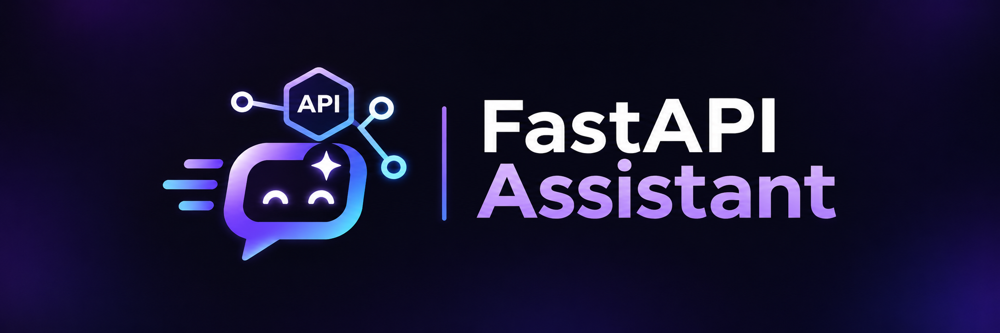

# RAG-Based Technical Documentation Assistant

<p align="center">
  
</p>

<p align="center">
  A Retrieval-Augmented Generation assistant for searching official FastAPI documentation using Semantic Search and BM25.
</p>

---

## Overview

The **RAG-Based Technical Documentation Assistant** is a web-based application designed to help software developers find relevant information from the official FastAPI documentation and receive clear, source-supported answers to natural-language technical questions.

The project was developed as a **BSc Software Engineering Final Year Project**.

The system combines **Retrieval-Augmented Generation (RAG)** with two information retrieval methods:

- Semantic / vector retrieval
- BM25 keyword retrieval

Users can ask technical questions about FastAPI, view generated answers, inspect supporting documentation sources and compare the performance of the two retrieval approaches.

---

## Project Aim

The aim of this project is:

> To design, implement and evaluate a web-based RAG documentation assistant that helps software developers find relevant FastAPI information and receive answers supported by authoritative sources.

---

## Research Questions

### Main Research Question

> How effectively can a RAG-based documentation assistant retrieve relevant FastAPI information and generate accurate, source-supported answers to natural-language technical questions?

### Secondary Research Question

> How does semantic/vector retrieval compare with BM25 keyword retrieval when searching FastAPI documentation?

---

## Target Users

The application is primarily designed for:

- Software engineering students
- Junior software developers
- Developers learning FastAPI
- Developers who need quick access to technical documentation

---

## Main Features

The application currently includes:

- Natural-language FastAPI question answering
- Retrieval-Augmented Generation
- Semantic/vector retrieval
- BM25 keyword retrieval
- Semantic vs BM25 comparison mode
- Source-supported generated answers
- Links to relevant FastAPI documentation
- Retrieval and generation timing information
- User registration and authentication
- Persistent chat history
- Searchable conversations
- Regenerate answer functionality
- Helpful / not helpful feedback
- Dark and light themes
- Responsive web interface
- Evaluation results dashboard
- One-click local application launcher

---

## Retrieval Methods

### Semantic Retrieval

Semantic retrieval attempts to understand the meaning of a user's question rather than relying only on exact keyword matches.

The project uses the pretrained embedding model:

```text
sentence-transformers/all-MiniLM-L6-v2
```

FastAPI documentation chunks are converted into vector embeddings.

When a user submits a question:

1. The question is converted into an embedding.
2. The query embedding is compared with stored documentation embeddings.
3. The most relevant chunks are selected.
4. These chunks are provided to the language model as context.

---

### BM25 Retrieval

BM25 is used as the traditional keyword-based retrieval baseline.

The FastAPI documentation is tokenised and indexed using BM25.

When a question is submitted, BM25 ranks documentation chunks according to keyword relevance.

This allows the project to compare traditional lexical search with semantic vector retrieval.

---

### Compare Mode

The application includes a **Compare** mode.

The same user question is processed using both:

- Semantic retrieval
- BM25 retrieval

The results can then be compared within the application.

This supports the project's secondary research question.

---

## RAG Pipeline

The main Retrieval-Augmented Generation pipeline is:

```text
User Question
      |
      v
Retrieval Method
      |
      +---------------------+
      |                     |
      v                     v
Semantic Search          BM25 Search
      |                     |
      +----------+----------+
                 |
                 v
   Relevant Documentation Chunks
                 |
                 v
        Prompt Construction
                 |
                 v
       Large Language Model
                 |
                 v
        Generated Answer
                 |
                 v
      Supporting Sources
```

The generated answer is therefore grounded in retrieved FastAPI documentation rather than being generated without supporting context.

---

## Documentation Corpus

The knowledge base is created from the official FastAPI documentation.

The document-processing pipeline includes:

1. Collecting FastAPI documentation URLs
2. Extracting documentation content
3. Cleaning the extracted text
4. Dividing documents into smaller chunks
5. Preserving source information
6. Generating semantic embeddings
7. Storing the processed data for retrieval

The current corpus contains approximately:

- **152 English FastAPI documentation pages**
- **4,012 documentation chunks**

The semantic embedding matrix contains:

```text
4012 x 384
```

dimensions.

---

## Evaluation

The system was evaluated using a prepared set of **20 FastAPI technical questions**.

Each question includes an expected documentation source and key answer points.

The evaluation compares the ability of Semantic retrieval and BM25 retrieval to locate the expected FastAPI documentation.

---

## Retrieval Evaluation Results

| Metric | Semantic | BM25 |
|---|---:|---:|
| Top-1 Accuracy | 65% | 40% |
| Top-3 Accuracy | 95% | 75% |
| Top-5 Accuracy | 95% | 80% |
| Mean Reciprocal Rank | 0.783 | 0.552 |

Semantic retrieval found the expected documentation within the top five results for **19 out of 20 questions**.

BM25 found the expected documentation within the top five results for **16 out of 20 questions**.

The current results indicate that semantic retrieval performs better than BM25 on the prepared FastAPI evaluation set.

---

## Answer Evaluation Results

| Metric | Semantic | BM25 |
|---|---:|---:|
| Answer Correctness | 71.7% | 61.7% |
| Source Support | 3 / 3 | 3 / 3 |
| Unsupported Claims | 0 | 0 |

The evaluation suggests that improved retrieval quality can contribute to stronger generated answers.

---

## Example Retrieval Difference

One example from the evaluation is the question:

> How do I run a task after returning a response from FastAPI?

The expected documentation concerns FastAPI **BackgroundTasks**.

Semantic retrieval ranked the expected documentation at **rank 1**, while BM25 did not retrieve it within the top five results.

This demonstrates how semantic retrieval can identify conceptually relevant documentation even when the wording of the user's question differs from the terminology used in the documentation.

---

## Technology Stack

### Backend

- Python
- FastAPI
- Uvicorn
- SQLite
- Jinja2

### Retrieval and RAG

- Sentence Transformers
- `all-MiniLM-L6-v2`
- NumPy
- BM25
- OpenAI language model API

### Frontend

- HTML
- CSS
- JavaScript

### Development Tools

- Visual Studio Code
- Git
- GitHub
- PowerShell

---

## Project Structure

```text
RAG-FastAPI-Assistant/
|
|-- data/
|   |-- fastapi_urls.txt
|   |-- fastapi_docs.json
|   |-- fastapi_chunks.json
|   `-- fastapi_embeddings.npy
|
|-- results/
|   `-- graphs/
|
|-- static/
|   |-- css/
|   |-- images/
|   `-- js/
|
|-- templates/
|
|-- main.py
|-- database.py
|-- auth.py
|-- auth_routes.py
|-- chat_routes.py
|-- chat_service.py
|-- chat_management.py
|-- feedback_routes.py
|-- about_page.py
|-- results_page.py
|-- evaluation_questions.json
|-- evaluate_retrieval.py
|-- validate_evaluation.py
|-- start_website.bat
`-- README.md
```

---

## Running the Application

### Option 1 - One-Click Launcher

On Windows, double-click:

```text
start_website.bat
```

The launcher starts the FastAPI server and automatically opens the application in the web browser.

The local application address is:

```text
http://127.0.0.1:8000
```

The server window must remain open while the application is being used.

---

### Option 2 - Run Using PowerShell

Open PowerShell inside the project directory and run:

```powershell
cd C:\Users\Riadh\RAG-FastAPI-Assistant
.\.venv\Scripts\python.exe -m uvicorn main:app --reload
```

Then open:

```text
http://127.0.0.1:8000
```

in a web browser.

---

## Environment Configuration

The application uses environment variables for external service configuration.

A local `.env` file can be used to store values such as API credentials.

Sensitive information should never be committed to GitHub.

Examples of information that should remain private include:

- API keys
- Passwords
- Access tokens
- Private credentials

The `.env` file should remain excluded from version control using `.gitignore`.

---

## Application Pages

### Assistant

The main interface allows users to ask FastAPI questions using:

- Semantic retrieval
- BM25 retrieval
- Compare mode

Generated answers include supporting documentation sources.

---

### About

The About page explains the purpose of the system and provides information about the RAG-based architecture.

---

### Results

The Results page presents the evaluation of the system, including:

- Top-1 accuracy
- Top-3 accuracy
- Top-5 accuracy
- Mean Reciprocal Rank
- Answer correctness
- Source support
- Retrieval performance graphs
- End-to-end response information

---

## Authentication and Chat History

The application includes user authentication and persistent conversations.

SQLite is used to store application information including:

- Users
- Chats
- Messages
- Retrieval methods
- Source information
- Response timing information
- User feedback

Users can return to previous conversations and search their saved chat history.

---

## Feedback

Users can provide feedback on generated responses using:

- Helpful
- Not helpful

This functionality provides a foundation for future analysis of user satisfaction and answer quality.

---

## Limitations

Current limitations include:

- The knowledge base currently focuses only on FastAPI documentation.
- The evaluation contains a relatively small set of prepared technical questions.
- Answer quality depends on the quality of retrieved documentation.
- Retrieval performance can vary depending on how a question is phrased.
- The application is currently primarily designed for local execution.
- The current evaluation does not represent every possible FastAPI question.

---

## Future Work

Possible future improvements include:

- Expanding the documentation knowledge base
- Increasing the evaluation dataset
- Testing alternative embedding models
- Testing reranking techniques
- Improving document chunking
- Evaluating additional retrieval algorithms
- Conducting wider user evaluation
- Improving mobile usability and accessibility
- Deploying the application as a public web service
- Supporting documentation from additional software frameworks

---

## Security and Privacy

Sensitive credentials are not intended to be stored directly in the source code.

External API credentials should be stored using environment variables or a local `.env` file.

User passwords are handled through the application's authentication system rather than being stored as plain text.

---

## Academic Context

This application was developed as a **BSc Software Engineering Final Year Project** investigating the use of Retrieval-Augmented Generation for technical documentation assistance.

The project evaluates whether semantic retrieval provides more effective access to FastAPI documentation than traditional BM25 keyword retrieval.

The work includes:

- Literature review
- Requirements analysis
- System design
- RAG implementation
- Full-stack web development
- Retrieval evaluation
- Answer evaluation
- Critical analysis of results

---

## Documentation Source

The knowledge base is derived from the official FastAPI documentation:

https://fastapi.tiangolo.com/

FastAPI documentation remains the property of its respective authors and maintainers.

---

## Project Status

The core implementation currently includes:

- RAG-based question answering
- Semantic retrieval
- BM25 retrieval
- Compare mode
- Source attribution
- User authentication
- Persistent chat history
- Feedback collection
- Evaluation tools
- Results visualisation
- Responsive interface
- One-click local launcher

The project is currently in its final testing, documentation and dissertation preparation stage.